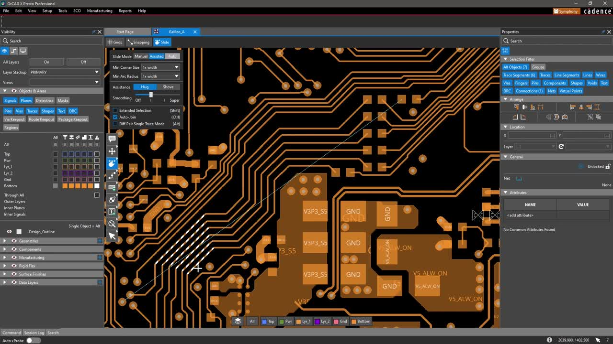
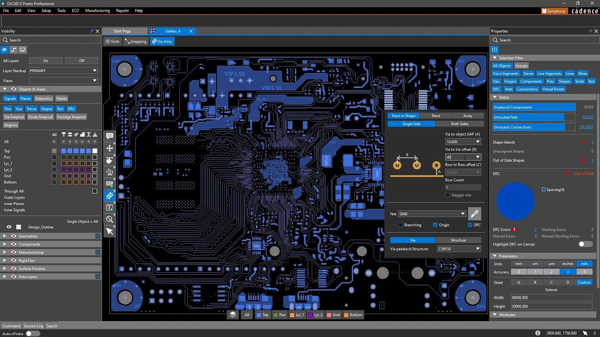

# OrCAD X for Schematic and PCB Design

OrCAD X connects schematic design, circuit analysis, PCB layout, and manufacturing preparation in the Cadence design environment.
This independent repository collects workflow notes and selected open-source EDA references.

[](https://orcad-x.github.io/Cadence-OrCAD-X/)

Cadence OrCAD X supports work from component selection through board review.
Available analysis, collaboration, and automation capabilities depend on the installed release and licensed configuration.

## Features for users

**OrCAD X Capture** provides the schematic side of the design workflow.
Keep component identities, pin assignments, and connectivity consistent before moving the design into layout.

**OrCAD X Presto** provides a PCB layout environment for placement, routing, and board inspection.
Use constraints to express design intent rather than relying on visual inspection alone.

**OrCAD X Professional** is one of the platform's licensing tiers.
Consult the current platform comparison before assuming that an analysis tool or collaboration feature is included.

| Design activity | Platform role | Review focus |
| --- | --- | --- |
| Schematic capture | Represent components and electrical connections | Symbols, pin mapping, and connectivity |
| Component selection | Associate design parts with library and sourcing data | Package, lifecycle, and approved alternatives |
| Circuit simulation | Explore modeled circuit behavior with PSpice | Models, stimuli, and analysis settings |
| PCB placement | Arrange components within board constraints | Mechanical fit, orientation, and access |
| Routing | Implement electrical connections on the board | Clearances, widths, and return paths |
| Design review | Inspect electrical and mechanical information | Rule results and unresolved exceptions |
| Manufacturing preparation | Produce controlled fabrication and assembly outputs | Revision consistency and output completeness |

A schematic symbol, a footprint, and a simulation model serve different purposes.
Check their relationship before reusing a library part in a new design.
A visually similar package is not enough to establish a correct pin mapping.

Live BOM and integrated component services provide information that supports part selection.
Treat availability and alternative-part suggestions as inputs to engineering review.



## Files

The bundled material comes from LibrePCB, a separate open-source EDA application.
It provides examples of application structure, graphics resources, and release tooling.
These files are not OrCAD X internals, plug-ins, or directly compatible project data.

For readers comparing desktop and command-line application boundaries:

- [main.cpp](apps/librepcb/main.cpp) is the LibrePCB desktop application entry point.
- [main.cpp](apps/librepcb-cli/main.cpp) is the separate LibrePCB CLI entry point.
- [commandlineinterface.h](apps/librepcb-cli/commandlineinterface.h) declares that project's command-line interface.
- [commandlineinterface.cpp](apps/librepcb-cli/commandlineinterface.cpp) implements its command handling.

Those CLI options belong to LibrePCB.
They should not be used as an OrCAD X command reference.

Three-dimensional board review combines geometry, placement, and display.
Check component height, orientation, and enclosure assumptions independently of the rendered appearance.

The included graphics and geometry references illustrate another EDA project's implementation:

- [3d-vertex-shader.glsl](share/librepcb/opengl/3d-vertex-shader.glsl) transforms geometry for display.
- [3d-fragment-shader.glsl](share/librepcb/opengl/3d-fragment-shader.glsl) calculates surface shading.
- [FindOpenCascade.cmake](cmake/FindOpenCascade.cmake) integrates an optional CAD geometry dependency.
- [FindDxflib.cmake](cmake/FindDxflib.cmake) locates a DXF library.
- [FindDelaunayTriangulation.cmake](cmake/FindDelaunayTriangulation.cmake) integrates a triangulation dependency.
- [FindMuParser.cmake](cmake/FindMuParser.cmake) integrates a mathematical expression parser.

These dependency files describe LibrePCB's build configuration.
They do not establish which libraries Cadence uses internally.

## Development

A repeatable OrCAD X workflow begins with clear design inputs.
Record the board revision, library sources, selected stackup, and intended manufacturing process.
Keep the approved schematic and layout revisions identifiable throughout review.

For a schematic review, consider:

- Reference designators and component values.
- Power connections and intentionally unconnected pins.
- Footprint assignments and pin-number correspondence.
- Simulation models for the analyses being performed.
- Differences between assembly variants.

For a layout review, consider:

- Board outline and mechanical restrictions.
- Placement, connector orientation, and component access.
- Routing rules appropriate to the selected stackup.
- Outstanding rule violations and documented exceptions.
- The relationship between approved design data and exported outputs.

Cadence documents Tcl scripting support for OrCAD X automation.
Application-specific database commands should come from documentation matching the installed tool.
The example below uses standard Tcl to check an illustrative list for duplicate reference designators.

```tcl
set references {R1 R2 C1 U1 R2}
set seen [dict create]
foreach reference $references {
    if {[dict exists $seen $reference]} {
        puts "Duplicate reference: $reference"
    }
    dict set seen $reference 1
}
```

The list is supplied explicitly; this script does not read the active schematic.
Use a documented application API or an exported report to obtain real design information before adapting it.

An exported BOM can also be checked with a separate system tool.
This PowerShell example finds rows with a blank manufacturer part number in an existing CSV.

```powershell
$bomRows = Import-Csv -LiteralPath 'C:\DesignReview\bom.csv'
$bomRows |
    Where-Object { [string]::IsNullOrWhiteSpace($_.MPN) } |
    Select-Object RefDes, Value, Footprint, MPN
```

The example assumes headers named RefDes, Value, Footprint, and MPN.
Map those names to the actual export columns before using it.
It reads the CSV and does not change the schematic, component library, or board database.

Project and library history need deliberate file-handling rules.
The bundled LibrePCB templates show how that project separates generated state from versioned content:

- [gitignore_template](share/librepcb/project/gitignore_template) excludes selected project-local and temporary files.
- [gitattributes_template](share/librepcb/project/gitattributes_template) controls automatic text conversion for project files.
- [gitignore_template](share/librepcb/library/gitignore_template) supplies library-specific ignore rules.
- [gitattributes_template](share/librepcb/library/gitattributes_template) controls automatic text conversion for library files.

Adapt version-control practices to the formats and collaboration tools used by the actual OrCAD X project.
Do not assume that another EDA application's ignore rules cover all Cadence design dependencies.



Before handing a design to manufacturing, review the entire output set as one revision.
Confirm the intended board, assembly variant, layer mapping, and drawing references.
Keep manufacturing outputs distinguishable from intermediate exports.

For an existing output folder, PowerShell can display SHA-256 hashes for later comparison.

```powershell
Get-ChildItem -LiteralPath 'C:\DesignReview\Manufacturing' -File |
    ForEach-Object {
        Get-FileHash -LiteralPath $_.FullName -Algorithm SHA256
    } |
    Select-Object Path, Algorithm, Hash
```

A hash helps detect a changed file.
It does not validate electrical correctness, fabrication settings, or agreement between different output formats.

The bundled release-tooling examples belong to LibrePCB:

- [build_librepcb.sh](ci/build_librepcb.sh) coordinates an application build.
- [stylecheck.sh](ci/stylecheck.sh) applies source-tree consistency checks.
- [build_windows_installer.sh](ci/build_windows_installer.sh) packages a Windows installer.
- [build_windows_archive.sh](ci/build_windows_archive.sh) assembles a Windows archive.
- [sign.ps1](ci/sign.ps1) performs code signing when the required environment is configured.
- [tar_artifacts.sh](ci/tar_artifacts.sh) collects build artifacts into an archive.
- [upload_artifacts.sh](ci/upload_artifacts.sh) signs and transfers artifacts in its upstream CI workflow.

These scripts document software release processes rather than PCB fabrication export.
They require the upstream build environment and are provided here as references for inspection.

### Requirements

Use Cadence's requirements for the exact OrCAD X release and selected products.
Check licensing, operating-system support, graphics requirements, and any additional analysis entitlements.
The LibrePCB build dependencies in this collection are separate from OrCAD X system requirements.

## Getting Help

The [OrCAD X product page](https://www.cadence.com/en_US/home/tools/pcb-design-and-analysis/orcad.html) describes the platform.
The [platform offerings page](https://www.cadence.com/en_US/home/resources/datasheets/orcad-x-platform-tiers.html) provides licensing comparisons.
Use the [Cadence documentation directory](https://resources.pcb.cadence.com/documentation-page) to locate product guides.

When reporting a design issue, identify the application release, active editor, relevant license configuration, and operation involved.
For project-specific errors, include a minimal reproducible example where sharing is permitted.
Questions about the bundled LibrePCB sources should be directed to that project's documentation and maintainers.

## License

OrCAD X is proprietary software distributed under Cadence's license terms.
The bundled LibrePCB materials retain their upstream licensing and attribution requirements.
This independent reference repository does not provide an OrCAD X license or redistribute the application.

## Related Search Terms

OrCAD X, Cadence OrCAD X, OrCAD X Capture, OrCAD X Presto, OrCAD X Professional, eda, pcb, schematic, electronics, cad, engineering, circuit, pcb-design, circuit-simulation, windows
